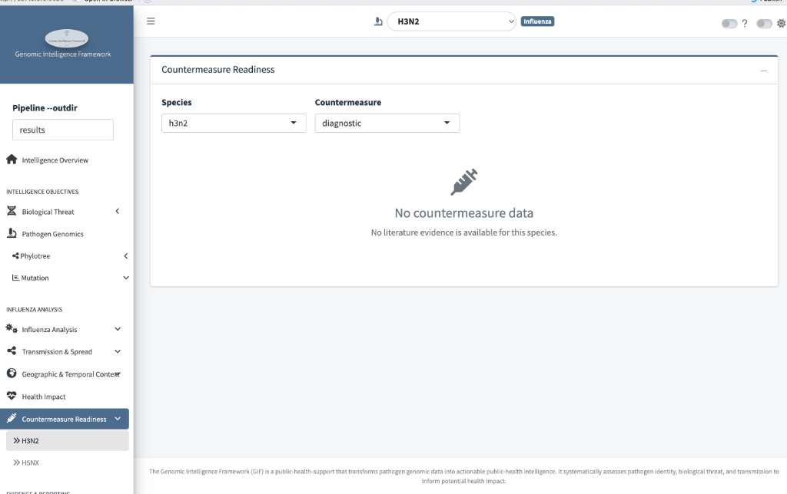

# Countermeasure Readiness

*Do vaccines, therapeutics, diagnostics, or policies exist for this
pathogen — and how strong is the evidence behind each?*

This page searches the pipeline's screened literature for countermeasure
evidence and summarizes it per domain. Two dropdowns drive everything:
**Species** and **Countermeasure** type.

## The four countermeasure domains

| Domain | What it summarizes |
|---|---|
| `diagnostic` | Test performance — sensitivity, specificity, PPV, NPV, limit of detection per named test |
| `vaccine_therapeutic` | Product efficacy/effectiveness per named vaccine or drug |
| `intervention` | Non-pharmaceutical intervention effectiveness & coverage (narrative) |
| `policy` | Policy/guidance evidence (narrative + policy table) |

## Reading the current state — an honest empty panel

The screenshot shows the real state of this run: **"No countermeasure data
— No literature evidence is available for this species."**

!!! warning "Empty means 'not computed', not 'none exist'"
    This message means the literature screening step produced no extracted
    claims for this species+domain — usually because the literature-
    evidence extraction wasn't run or yielded nothing, **not** that H3N2
    has no diagnostics or vaccines (it plainly does). Treat an empty page
    as a data gap to flag, never as a negative finding. The same applies
    to the `0/11` evidence-coverage figure on the Intelligence Overview.

## What the page looks like once evidence exists

When screened literature is available for a species, the page fills in top
to bottom:

1. **Coverage strip** — a one-line count: *"X of Y screened papers yielded
   claims"* for the selected domain, plus the overall total. This is the
   first honesty check — thin denominators mean thin conclusions.
2. **Narrative summary** (for `intervention` and `policy`) — a generated
   plain-text summary of the evidence, labelled with its source
   (`ollama`/`template`) the same way as elsewhere.
3. **Metric selector + forest plot** (for `diagnostic`,
   `vaccine_therapeutic`) — pick a metric (e.g. *sensitivity*,
   *efficacy*) and see each study's estimate with its confidence interval
   plus the **pooled estimate** across studies — the literature's combined
   answer.
4. **Product / policy table** — the per-product or per-policy rows behind
   the plot: name, metric values, study design, phase, endpoints, and the
   other context fields extracted from each paper.

!!! tip "How to use the forest plot"
    - Points are individual studies; the diamond/pooled row is the
      combined estimate.
    - Wide intervals = few or noisy studies; a pooled estimate sitting on
      2–3 papers is a weak foundation for decisions.
    - Consistent estimates across studies carry more weight than one
      strong outlier.

## What to watch for

1. **Coverage denominators first** — "3 of 40 papers yielded claims" is a
   different world from "30 of 40".
2. **Established countermeasures vs your query's biology** — cross-check
   with the phenotype markers (e.g. an `M2:S31N` hit makes amantadine
   evidence irrelevant for that genome).
3. **Narrative summaries are starting points** — click through to the
   underlying table rows before quoting numbers.

!!! warning "Limitations"
    - Evidence comes only from the **screened literature set** — what the
      pipeline retrieved and extracted, not the world's literature.
    - Pooled estimates inherit the biases of included studies (design,
      phase, setting).
    - An empty domain is a gap to close, not a finding to report.
