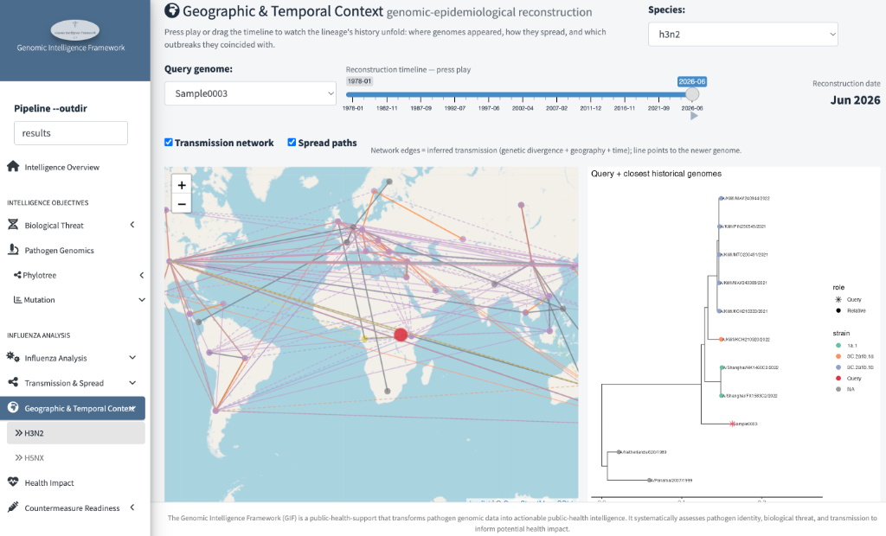
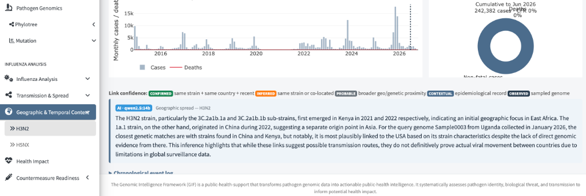

# Geographic & Temporal Context

*Where and when was this lineage — and its relatives — circulating?*

This page is the **genomic-epidemiological reconstruction**: it replays the
lineage's history on a map — where genomes appeared, how they spread, and
which outbreaks they coincided with. Press play on the timeline, or drag it
to any date, and everything on the page rebuilds to that moment.

## Step 1 — The reconstruction view

- **Timeline slider (top)** — from the lineage's first record (`1978-01`)
  to the latest (`2026-06`). Press play to animate history; drag to pause
  at a date — the **Reconstruction date** (`Jun 2026`) shows where you are.
- **The map** — each point is a sampled genome (size roughly by count at
  that location); the red marker is the query in Uganda. Two overlays can
  be toggled:
    - **Transmission network** — edges linking genetically related
      genomes: *inferred* links combining genetic divergence + geography +
      time, with the line pointing toward the newer genome.
    - **Spread paths** — the reconstructed movement routes between
      locations.
- **Right panel** — the query + closest historical genomes subtree, so the
  map and the family tree stay side by side.

!!! warning "Inferred edges are hypotheses, not contact tracing"
    A dashed line from China to Uganda says "these two genomes are close
    relatives in space-time" — it does **not** prove the virus travelled
    that route; unsampled intermediates are common, and the legend below
    grades how strong each link actually is.

## Step 2 — Cases, deaths, and the cumulative toll

- **Monthly cases/deaths timeline** — the epi curve behind the map; the
  dashed line marks the reconstruction date. Only the period *up to* your
  slider position counts.
- **Cumulative donut** — the running total at that date: here `242,382
  cases, CFR 0%` — severity context for the whole lineage at a glance.
- **Link confidence legend** — the graded honesty scale for every edge on
  the map, strongest to weakest:

    | Label | Meaning |
    |---|---|
    | `CONFIRMED` | same strain + same country + recent |
    | `INFERRED` | same strain or co-located |
    | `PROBABLE` | broader geo/genetic proximity |
    | `CONTEXTUAL` | epidemiological record only |
    | `OBSERVED` | a directly sampled genome |

    When a link looks important, check its grade before citing it —
    `CONTEXTUAL` is background colour, not evidence of a route.

- **AI geographic note** — the local LLM's reading of the reconstruction
  (here: 3C.2a1b.1a/1b sub-strains emerging in Kenya in 2021/2022, the
  1a.1 strain originating in China, and Sample0003's closest matches in
  China and Kenya while its strain characteristics point to the USA). It
  ends with the correct caveat itself: *links suggest possible routes —
  they do not definitively prove movement between countries*.

- **Chronological event log** (below) — the same history as a dated list,
  for readers who prefer text to the animation.

## What to watch for

1. **The reconstruction at the query's sampling date** — scrub to it and
   see which relatives were circulating nearby at that moment.
2. **`CONFIRMED`/`INFERRED` edges into the query's country** — the
   plausible importation routes worth follow-up.
3. **Convergence of independent signals** — when the tree, the map links,
   and the epi curve all point the same direction, the story is strong;
   when only the network edges do, it isn't.

!!! warning "Limitations"
    - The map shows **sampled** genomes — undersampled countries are
      invisible, which can invent "gaps" and reroute inferred paths.
    - Country centroids are used for locations; an edge connects *countries*,
      not cities or individuals.
    - Cumulative counts reflect **reported** cases — under-reporting
      understates them.
    - The AI note summarizes the same data you can see; treat its
      geographic phrasing as suggestive, always checking the link-
      confidence grade.
