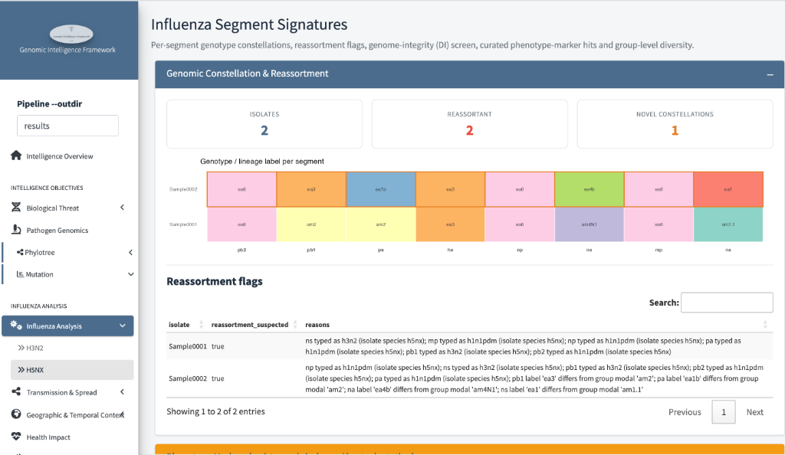
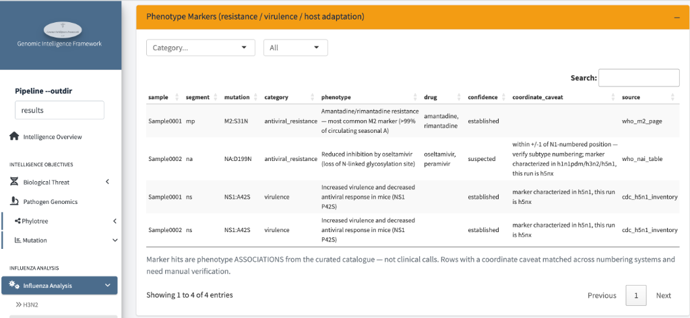
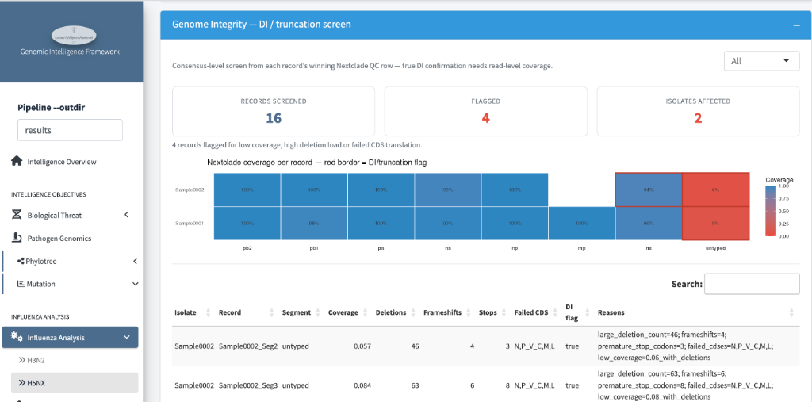

# Influenza Analysis

*Do the eight segments tell a coherent story — or a reassortant, defective,
or phenotypically interesting one?*

This page only exists for **influenza** (H3N2, H5NX) — influenza's genome
comes in eight separate segments that reassort with each other, so it needs
checks Ebola doesn't. It answers three influenza-specific questions:

1. **Where did each segment come from?** — genotype constellation &
   reassortment
2. **Does it carry known drug-resistance or virulence markers?** — phenotype
   markers
3. **Are any segments broken?** — genome integrity / DI screen

The example below is the **H5NX** run.

---

## Step 1 — Genomic constellation & reassortment

Each segment is typed against its own reference set, then the eight labels
are laid side-by-side — the "genotype constellation":

- **Headline counts** — isolates screened, how many look like
  **reassortants**, and how many carry a **novel constellation** (a segment
  combination not seen in the background set).
- **The coloured strip** — one row per isolate, one column per segment
  (pb2 → ns). Each cell is that segment's genotype/lineage label. A row of
  the same colour family = a coherent genotype; a row mixing labels from
  different subtype families = a mosaic.
- **Reassortment flags table** — per isolate, `true/false` and *why*: e.g.
  "ns typed as h3n2 … np typed as h1n1pdm … pa typed as h1n1pdm (isolate
  species h5nx)" — segments whose typing disagrees with the isolate's
  declared species, or labels that differ from the group's modal
  constellation.

!!! warning "How to read a reassortant flag"
    Reassortment is normal influenza biology — a flag means *"these
    segments have different histories"*, not *"this is dangerous"*. It
    becomes important when a marker (Step 2) or a novel constellation comes
    along with it.

## Step 2 — Phenotype markers

The pipeline checks the query against a curated catalogue of mutations
with published associations — **antiviral resistance**, **virulence**, and
**host adaptation**:

Read across each row:

- **mutation / category / phenotype** — e.g. `M2:S31N` →
  `antiviral_resistance` → "Amantadine/rimantadine resistance — most common
  M2 marker (>99% of circulating seasonal A)".
- **drug** — which countermeasure the association affects, where relevant
  (amantadine, oseltamivir, peramivir).
- **confidence** — `established` (well-replicated literature) vs
  `suspected` (reported but weaker).
- **coordinate_caveat** — the honesty column: e.g. *"within +/-1 of
  N1-numbered position — verify subtype numbering"* or *"marker
  characterized in h5n1, this run is h5nx"*. Numbering differs between
  subtypes, so a hit may need manual confirmation.
- **source** — the catalogue entry it came from (`who_m2_page`,
  `who_nai_table`, `cdc_h5n1_inventory`, …).

!!! note "Associations, not verdicts"
    The page footer says it plainly: these are *phenotype associations from
    a curated catalogue — not clinical calls*. `M2:S31N` tells you
    amantadine almost certainly won't work; `NA:D199N` says "suspected"
    reduced oseltamivir inhibition — worth flagging to the lab for
    phenotypic testing, not enough alone to change treatment guidance.
    Rows with a coordinate caveat always need a human check first.

## Step 3 — Genome integrity (DI / truncation screen)

A **defective-interfering (DI) or truncated segment** is a sequencing or
biological red flag — this screen scans each record's Nextclade QC for
signs of one:

- **Headline counts** — records screened, flagged, isolates affected.
- **Coverage tiles** — one column per segment, one row per record; colour =
  coverage, **red border = DI/truncation flag**. In the example both
  isolates have a pale/red `untyped` cell at ~0–9% — a segment that
  essentially failed to assemble.
- **Flag table** — the evidence per flagged record: coverage, deletion
  count, frameshifts, premature stops, failed CDS translations, and the
  full reason string (e.g. `large_deletion_count=46; frameshifts=4;
  premature_stop_codons=3; failed_cds=N,P_V_C,M,L; low_coverage=0.06_with_deletions`).

!!! warning "What a flag means — and doesn't"
    - Most flags are **assembly/sequencing problems**: a segment that
      failed to assemble is *missing data*, not necessarily a biologically
      defective particle. Check before interpreting it biologically.
    - A flag also **weakens every other panel for that segment** — its
      tree placement, typing, and mutation calls are unreliable, and this
      is often *why* a segment shows as `untyped` in the constellation.
    - True DI confirmation needs **read-level coverage** — this is a
      consensus-level screen, as the page itself states.

## What to watch for

1. **Reassortant + marker together** — a novel constellation carrying a
   resistance/virulence marker is the combination that escalates interest.
2. **Established-confidence resistance markers** — `M2:S31N`-type hits feed
   directly into the Countermeasure Readiness page.
3. **Flagged segments** — treat every downstream claim about that segment
   as provisional until re-sequenced.

!!! warning "Limitations"
    - Constellation labels depend on the typing reference set — an unusual
      label can mean "novel" or "unrepresented in the background".
    - Marker hits transfer *between subtypes* imperfectly (see the
      coordinate-caveat column).
    - The DI screen is consensus-level and conservative — it errs toward
      flagging poor assemblies.
