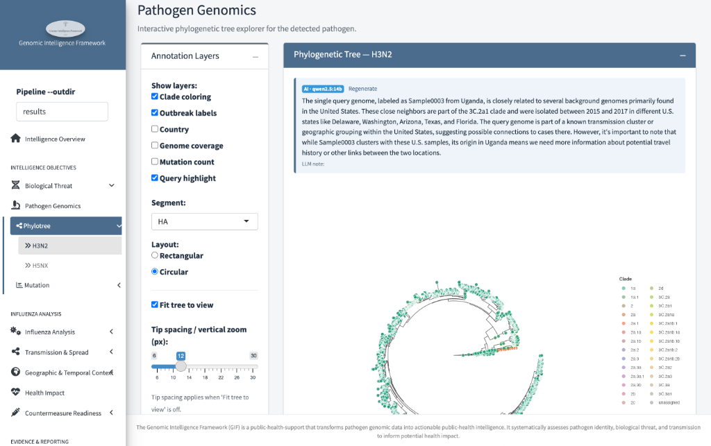
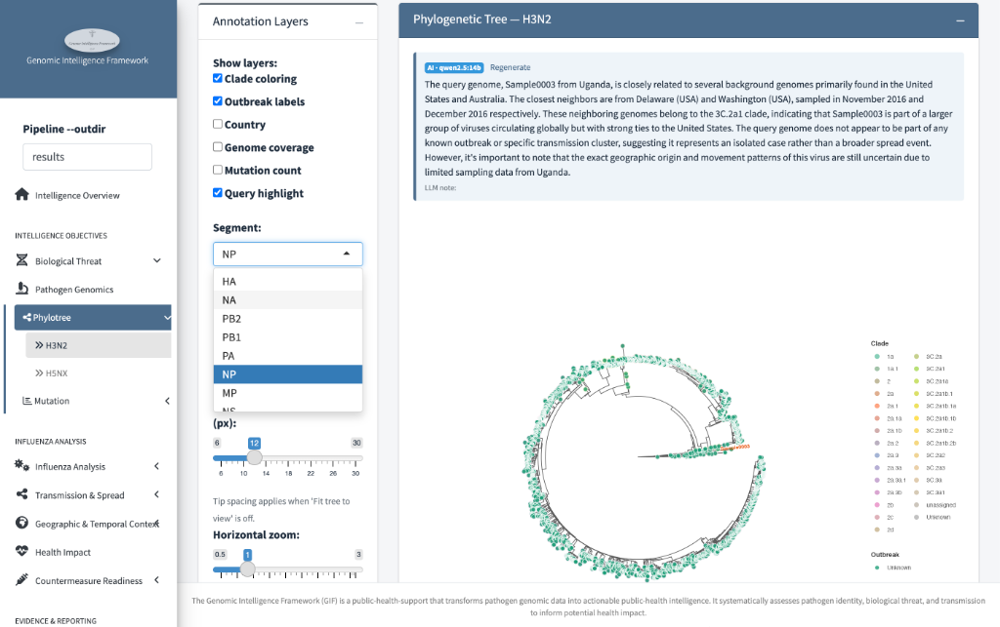
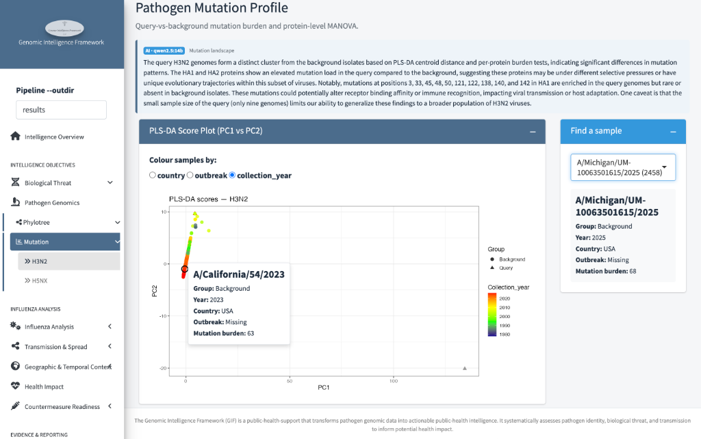
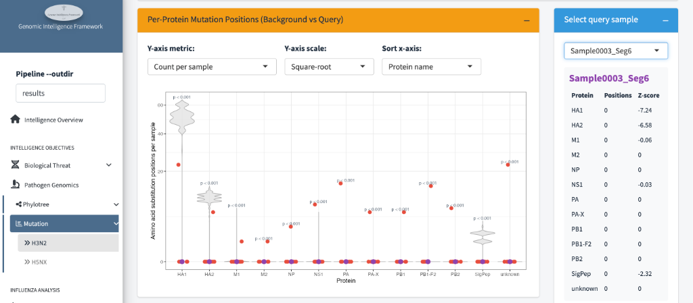
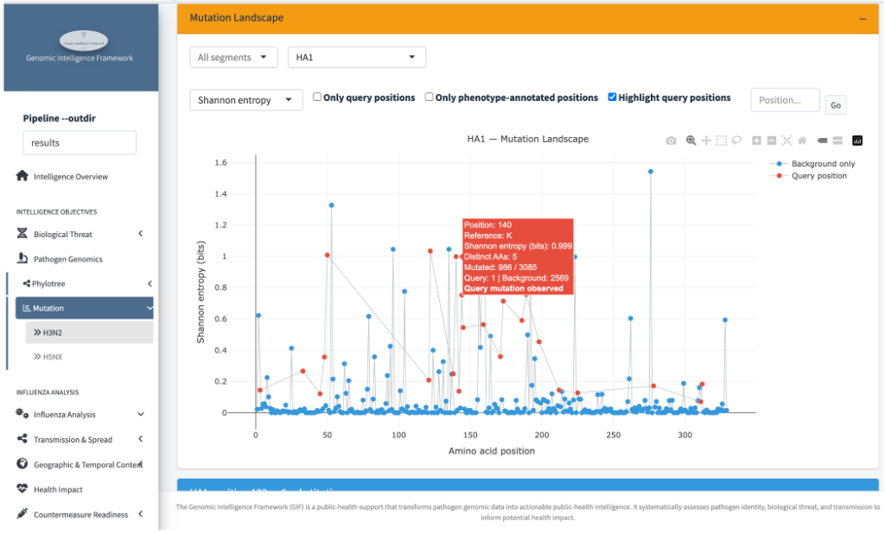
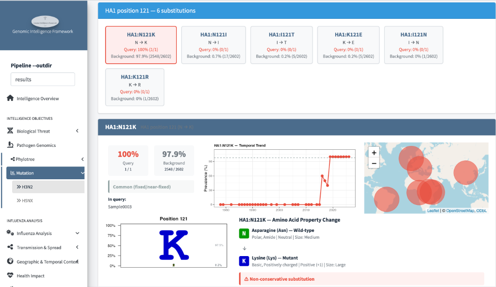

# Pathogen Genomics

*Where does this virus sit on the family tree — and which mutations set it
apart?*

Pathogen Genomics has two sub-pages in the sidebar:

- **Phylotree** — the phylogenetic tree: how your genomes relate to known
  background viruses.
- **Mutation** — the mutation profile: which changes distinguish your
  genomes and whether any of them matter.

Both work the same way for every pathogen; for influenza, a **segment
selector** additionally lets you look at each of the eight genome segments
separately.

---

## Part 1 — Phylotree

### Step 1 — Choose what to show on the tree

The **Annotation Layers** panel (left) toggles what each tip displays:

- **Clade coloring** — tips coloured by their family group (the clade names
  appear in the legend).
- **Outbreak labels** — mark tips belonging to known named outbreaks.
- **Country / Genome coverage / Mutation count** — colour tips by where they
  were collected, how complete the sequence is, or how many mutations they
  carry.
- **Query highlight** — marks your submitted genomes so they stand out
  against the background.

The tree itself can be drawn **Rectangular** or **Circular**, with
**Fit tree to view** and the spacing/zoom sliders to adjust readability.

!!! tip "How to read the tree"
    Tips are genomes; branch length is *genetic distance* — how many
    mutations separate them. Your query sitting on a short branch inside a
    well-known clade means "looks familiar"; a query on a long branch away
    from everything means "unusual" — worth a closer look, not a verdict.

### Step 2 — Switch genome segments (influenza)

For segmented viruses, the **Segment** dropdown swaps the whole tree — each
segment has its own evolutionary history:

This matters because a query can look typical on HA but unusual on NP — an
early hint of **reassortment** (segments with different histories being
inherited together). Comparing where the query sits across segments is one
of the most informative quick reads for influenza.

### Step 3 — Read the AI tree note

Above the tree, a short paragraph summarizes the placement — in the example
it notes that `Sample0003` from Uganda clusters with U.S. background genomes
of the 3C.2a1 clade sampled in 2016, and cautions that the geographic link
can't be resolved from the data alone.

- The **AI badge** (`qwen2.5:14B`) means it was written by the local LLM;
  `template` would mean a fixed-rule summary instead.
- **Regenerate** asks the LLM for a fresh wording of the same facts.
- The note is a *reading aid* — every claim in it traces to the tree data
  underneath. When it says "uncertain", that's the honest answer, not a
  hedge.

Below the tree, a **Tip Details** table lists the same information
per genome (clade, country, date, divergence) for precise lookup.

---

## Part 2 — Mutation profile

### Step 4 — The overview: PLS-DA score plot

The **PLS-DA score plot** compresses all mutation differences into two axes —
points that cluster together carry similar mutation profiles:

- **Colour samples by** — `country`, `outbreak`, or `collection_year`
  (shown: a year gradient, older samples dark, recent bright).
- **Click any point** to see what it is — the tooltip shows the sample name,
  group (Background/Query), year, country, outbreak, and mutation burden.
- **Find a sample** (right) — jump straight to a named genome.
- The AI **Mutation landscape** note on top summarizes what the plot means
  for this run.

!!! note "What to look for"
    If your query points sit *inside* the background cloud, its mutations
    look typical. A query drifting away on PC1 or PC2 carries an unusual
    combination of changes — the next steps tell you which ones.

A **MANOVA** table beneath the plot tests formally whether the query group
differs from background.

### Step 5 — Per-protein mutation positions

The next panel asks *which proteins carry unusual mutations?*

- Each x-axis position is a **protein**; the grey violins show the spread of
  mutation counts across all background genomes; the red dot is your
  selected query.
- `p < 0.001` labels flag proteins where the query's count is unusual.
- Pick a different query in the right-hand selector — its per-protein
  positions and z-scores update in the table beside it.
- The **Y-axis metric/scale** and **Sort x-axis** controls re-arrange the
  view.

A query dot above its violin — e.g. on HA — means that protein carries more
substituted positions than background relatives usually do.

### Step 6 — The mutation landscape

The **Mutation Landscape** zooms down to single amino-acid positions: for
every position in the selected protein, how *variable* it is across all
background genomes (Shannon entropy — tall peak = the position changes a lot
across strains):

- **Segment / protein dropdowns** choose which protein to show (`HA1`
  shown).
- **Red dots** mark positions where *your query* differs from the reference —
  read them against the background entropy: a red dot on a tall peak is a
  mutation at a commonly-varying position (likely tolerated); a red dot on a
  flat, conserved position is more interesting — backgrounds almost never
  change there.
- Checkboxes restrict the view to **query positions** or
  **phenotype-annotated positions**; the position box jumps to a residue.
- Hover any point for the details: reference residue, entropy, how many
  background/query genomes are mutated there.

### Step 7 — One mutation in depth

Clicking a position opens the detail card — everything the pipeline knows
about that substitution:

- **Substitution chips** (top) — every amino acid seen at that position, with
  its share of query and background genomes (N→K at 100% of the query,
  97.9% of background).
- **Temporal trend** — when that variant rose in circulation (here, the K
  variant swept in around 2017 — a historical fixation, not a new event).
- **Geographic map** — where genomes carrying it were sampled.
- **Sequence logo** — which residues dominate that position overall.
- **Amino-acid property change** — whether the swap changes the chemistry:
  here *Asparagine (polar, neutral) → Lysine (basic, positive)*, flagged
  **Non-conservative substitution** — the kind worth a virologist's
  attention even though it's common in background.
- Where the pipeline's annotation data covers it, the card also reports
  documented **phenotype/biological significance** (resistance, virulence,
  host adaptation).

!!! note "How to weigh a mutation"
    High background prevalence + an old temporal rise = established
    variant, probably tolerated by the virus. Rare/absent in background +
    non-conservative chemistry + a phenotype annotation = the mutations
    genuinely worth flagging.

## What to watch for

1. **Tree placement** — inside a known clade (familiar) vs a long isolated
   branch (worth scrutiny).
2. **Per-segment disagreement (flu)** — different stories on different
   segments suggest reassortment.
3. **Query-specific mutations on conserved positions** — especially
   non-conservative ones with documented phenotypes.

!!! warning "Limitations"
    - The tree shows *sampled* history — unsampled transmission is
      invisible.
    - PLS-DA and MANOVA describe association, not causation.
    - Landscape entropy needs translated protein files; segments lacking
      translations can show a flat line (see
      [Troubleshooting](../troubleshooting.md)).
    - The AI note is a summary aid — the numbers in the tables are the
      ground truth.
