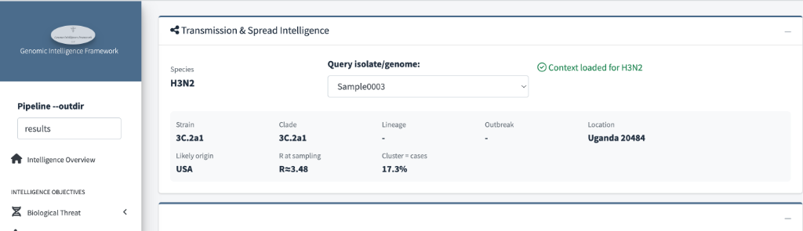
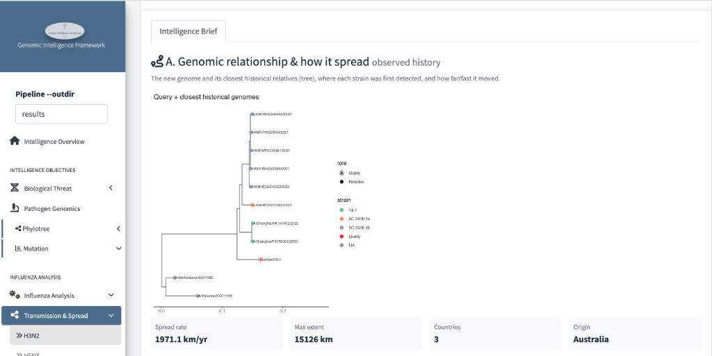
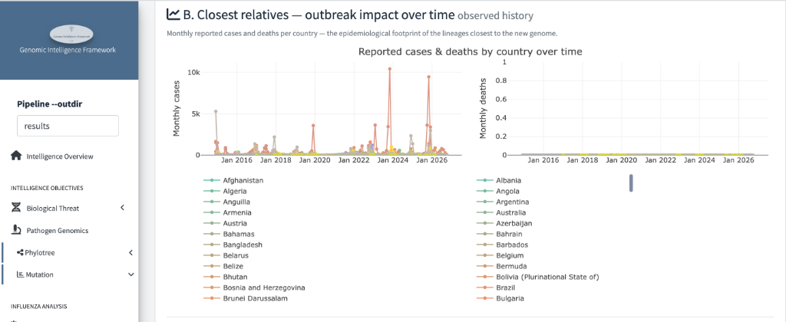
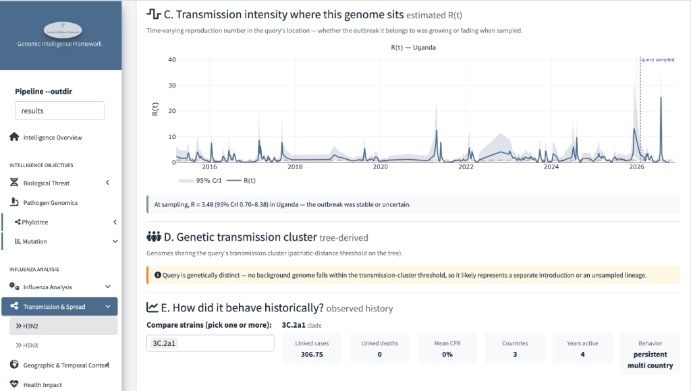
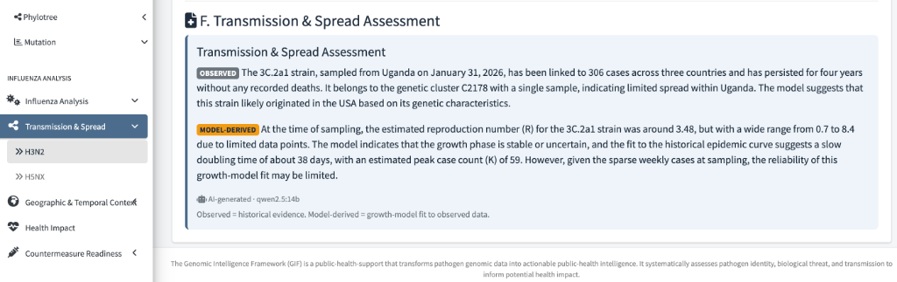

# Transmission & Spread

*How did this lineage spread historically, how intense was transmission
where the query sits, and is the query part of an ongoing cluster?*

This page reads like a short report in six labelled sections — **A through
F** — moving from the query's place on the tree to a final assessment
statement. Every number in it is either *observed history* or a fitted
estimate on observed data; nothing projects the future.

!!! note "No forecasts by design"
    Earlier versions projected future cases. That was removed: the pipeline
    doesn't collect enough covariates to project responsibly, so this page
    reports observed history and fitted estimates only.

## The header — pick a genome, get its dossier

Choose the query in the dropdown — everything below updates. The strip then
answers "what do we already know about this genome?":

- **Strain / Clade / Lineage / Outbreak** — its family placement (`3C.2a1`,
  no named outbreak here).
- **Location** — where it was collected (`Uganda`).
- **Likely origin** — the background country its closest relatives point to
  (`USA`) — a *phylogenetic hint*, not travel-history proof.
- **R at sampling** — transmission intensity where/when it was collected
  (`R≈3.48`; section C shows the uncertainty around it).
- **Cluster = cases** — what fraction of the cluster's genomes map to
  reported cases (`17.3%`) — a rough genomics-to-epidemiology bridge.

## A. Genomic relationship & how it spread — *observed history*

The tree shows the query (red star) among its closest sampled relatives;
below it, the lineage's movement summary:

- **Spread rate** — `1971.1 km/yr`: how fast this lineage moved
  geographically across its sampled history.
- **Max extent / Countries / Origin** — `15126 km` span, `3` countries,
  origin `Australia` (where the deepest sampled ancestor sits).

!!! tip "Read 'origin' cautiously"
    Origin and spread rate are computed from *sampled* genomes — they
    describe where the sequenced record starts, which can lag or miss the
    true source country entirely.

## B. Closest relatives — outbreak impact over time — *observed history*

For the countries where the query's closest relatives circulated, the
panels show **monthly reported cases** (left) and **monthly deaths**
(right) — the real-world footprint of the lineage your genome belongs to.

In the H3N2 example, cases show clear seasonal peaks through 2016–2026
while deaths stay essentially flat — a high-circulation, low-severity
profile typical of seasonal influenza rather than, say, an Ebola
signature. This is the *epidemiological* counterpart to the genetic tree.

## C. Transmission intensity — *estimated R(t)*

The R(t) curve plots the time-varying reproduction number in the query's
location, with the dashed line marking when the query was sampled:

- **At sampling, R = 3.48 (95% CrI 0.70–8.38)** — the credible interval is
  the honest part: with sparse data it spans "under control" to
  "growing fast", so the dashboard concludes *stable or uncertain* rather
  than pretending precision.
- Shaded band = 95% credible interval; spikes earlier in the series are
  past transmission surges at that location.

!!! warning "R(t) is a location estimate, not a genome property"
    R(t) describes transmission *in that place at that time*, estimated
    from reported cases — it isn't a property of this virus specifically,
    and wide intervals mean "we can't tell", not "we can't be bothered".

## D. Genetic transmission cluster — *tree-derived*

The orange callout says it directly:

> Query is genetically distinct — no background genome falls within the
> transmission-cluster threshold, so it likely represents a separate
> introduction or an unsampled lineage.

"Cluster = cases" in the header and this section are the same idea at
different scales: does the query sit inside a sampled transmission
cluster? Here the answer is *no* — which usually means either a separate
introduction or, very commonly, that the actual cluster simply wasn't
sequenced.

## E. How did it behave historically? — *observed history*

Compare the query's strain (and optionally others) on its track record:

- `3C.2a1`: **306.75** linked cases, **0** linked deaths, **0%** mean CFR,
  **3** countries, **4** years active, behaviour = **persistent,
  multi-country**.

This is the strain's *resume* — the counterfactual question it answers is
"what has this lineage done before?", which is the strongest observed
evidence for what it might do again.

## F. Transmission & Spread Assessment

The final card writes the conclusions in two clearly-labelled voices:

- **OBSERVED** — what the historical record shows: *"linked to 306 cases
  across three countries … persisted for four years without recorded
  deaths … likely originated in the USA based on its genetic
  characteristics."*
- **MODEL-DERIVED** — what the fitted estimates add: *"R ≈ 3.48 with a
  wide range of 0.7–8.4 … growth phase stable or uncertain … slow doubling
  time of about 38 days … sparse weekly cases, so reliability may be
  limited."*

The footer states the rule the whole pipeline follows: *Observed =
historical evidence. Model-derived = growth-model fit to observed data.*
The AI-generated tag (`qwen2.5:14b`) marks the prose; the numbers are the
pipeline's.

!!! warning "Limitations"
    - **R(t) and spread rate** inherit every gap in case reporting and
      sequencing density — wide credible intervals are the norm in sparse
      settings.
    - **Origin / likely origin** describe the *sampled* record; undersampled
      regions routinely misattribute it.
    - **"Genetically distinct" ≠ "new lineage"** — it most often means the
      real cluster wasn't sequenced.
    - The assessment card is a summary; the numbers in sections A–E are the
      evidence to cite.

## What to watch for

1. **R(t) with a credible interval clearly above 1** at sampling — this
   example is ambiguous, a sustained R > 1 with tight bounds is not.
2. **Query inside a defined cluster** with a short branch to a named
   outbreak — the closest thing to "ongoing transmission" genomics can show.
3. **A strain resume that disagrees with the badge** — e.g. `MONITOR` next
   to a lineage with documented high-CFR history would deserve a second look.
