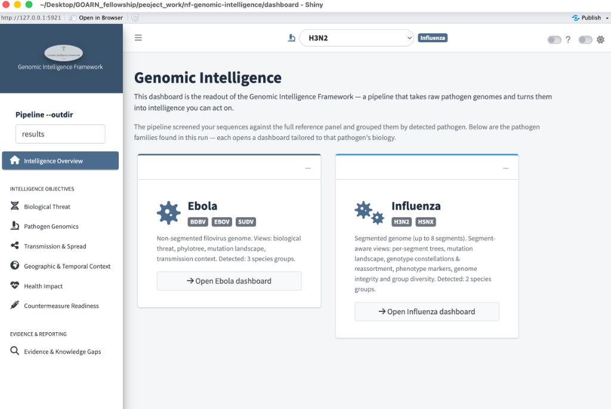

# Launching the dashboard

The dashboard is a standalone Shiny app — it is **not** part of the Nextflow
run. Run the pipeline first, then launch the app whenever you want to browse
results.

## Start it

From the repository root:

```bash
conda activate pgirl_dashboard
Rscript -e "shiny::runApp('dashboard')"
```

This starts a local web server and opens your browser (typically
`http://127.0.0.1:port`). Leave the terminal running — closing it ends the
session. In RStudio you can also open `dashboard/app.R` and click **Run App**.

<!-- screenshot: images/navigation/00-launch.png — terminal + browser opening on the family-cards page -->

## Point it at your results

The only thing the app needs to know is where your `--outdir` is.

1. In the sidebar, find the **Pipeline --outdir** field at the top.
   <!-- screenshot: images/navigation/01-outdir-field.png -->
2. It defaults to `results` (i.e. `../results` relative to `dashboard/`).
   Type a different path if your run went elsewhere — absolute paths,
   `~/…`, and repo-root-relative names all work.
3. The whole dashboard refreshes against that directory.

!!! info "What 'no species found' means"
    If every page says *No species found*, the app can't see
    `<outdir>/pathogen_identification/`. Either the pipeline hasn't run yet,
    or `--outdir` points somewhere else — check the field first.

## Pick a pathogen

When results are found, the landing page shows one card per detected
**pathogen family** — so you choose the group of viruses you want to look at
before diving into species-level detail.



In this example run you would pick between the two:

- **Ebola** — opens views for its detected species (*BDBV, EBOV, SUDV*): the
  biological-threat tables, the family tree, the mutation landscape, and
  transmission context.
- **Influenza** — opens views for its species (*H3N2, H5NX*): everything
  Ebola gets, **plus** per-segment analyses because influenza carries eight
  genome segments — genotype constellations, reassortment flags, segment
  integrity and group diversity.

Click **"Open … dashboard"** on a card to enter that family's Intelligence
Overview. From then on:

- The **navbar switcher** (top centre) shows the current species and lets
  you switch to any other detected one at any time.
- The **sidebar** shows the full menu for that family's species.

## Light & dark mode

The dark-mode toggle (moon/sun icon in the navbar) is supported throughout;
all charts and tables have dark variants. Screenshots in this guide use light
mode for print readability.

## Stopping

`Ctrl+C` in the terminal (or stop the R session). Nothing is persisted —
the app is read-only against your `results/` directory.
